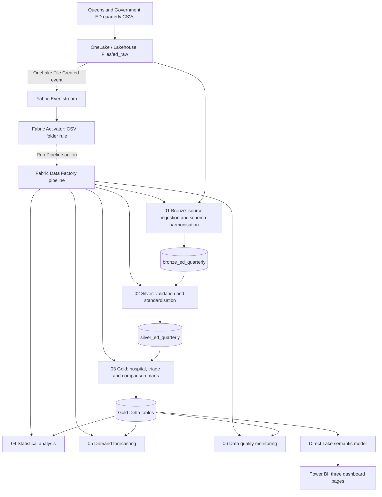

# Queensland Clinical Data Analytics

**An end-to-end Microsoft Fabric portfolio project for Queensland Emergency Department (ED) operational analytics — from public-data ingestion and quality checks to clinical KPI reporting, statistical analysis, demand forecasting and event-driven orchestration.**

> **Project status:** The ED analytics solution, Power BI dashboard, six-stage pipeline and Activator-to-pipeline action have been implemented and successfully executed. An actual **new-CSV-arrival → automatic pipeline run** has **not yet been verified end to end**. The system is a portfolio demonstration, not a deployed Queensland Health reporting service.

## Project at a glance

| Area | Implementation |
|---|---|
| Data source | Public Queensland Government quarterly ED performance CSVs |
| Reporting period | 11 included quarters, March 2023–September 2025 |
| Coverage | 105 distinct reporting facility/HHS codes in the source data |
| Bronze / Silver | 6,930 source records in each layer |
| Gold | 1,155 facility-quarter records and 5,775 triage-level records |
| Engineering | Microsoft Fabric Lakehouse, OneLake, PySpark, Delta Lake, Data Factory pipeline |
| Analytics | SQL, descriptive statistics, trends, correlation analysis, demand forecasting |
| Reporting | Power BI Direct Lake semantic model and three-page dashboard |
| Orchestration | Six linked notebook activities, plus Eventstream → Activator rule |
| Data governance | Source lineage, schema harmonisation, duplicate checks, KPI range checks, missingness monitoring |

## 1. The problem

Emergency departments generate operational indicators that can help analysts understand patient demand, waiting-time performance and service variation. However, publicly published quarterly files must be reconciled across reporting periods before they can support reliable comparisons.

This project addresses several practical analytics challenges:

- **Changing source schemas:** column names and available fields differ across quarterly CSV files.
- **Different reporting grains:** the `ALL` triage summary and individual categories 1–5 must not be double-counted.
- **Missing clinical indicators:** some performance fields are blank or not applicable; missing values should not automatically become zero.
- **Hospital comparisons:** activity volumes and case mix differ, so headline percentages require context.
- **Time-series uncertainty:** forecasts from a short quarterly history must be benchmarked and interpreted conservatively.
- **Operational reproducibility:** ingestion, transformation, analytics and quality checks should run in a repeatable sequence.

**Goal:** Build a transparent, auditable clinical-operations analytics workflow suitable for demonstrating applied data engineering and analytics skills using **non-patient-level public data**.

## 2. Solution architecture



**Execution note:** The Activator **Run Pipeline action was tested successfully**, and a pipeline run completed successfully. A real qualifying CSV-arrival event triggering the entire chain automatically remains to be tested. The diagram represents the configured workflow, not proof of completed production automation.

### Technologies

| Component | Purpose |
|---|---|
| **Microsoft Fabric Lakehouse / OneLake** | Raw source storage and managed Delta tables |
| **Fabric Spark notebooks / PySpark** | Ingestion, cleaning, transformations and analytics |
| **Delta Lake** | Persist Bronze, Silver and Gold outputs |
| **Fabric Data Factory** | Execute the six notebooks in dependency order |
| **SQL analytics endpoint** | Query and validate analytical outputs |
| **Power BI / Direct Lake** | Semantic modelling and interactive reporting |
| **Fabric Eventstream** | Receive OneLake file-created events |
| **Fabric Activator** | Apply file-path rules and submit pipeline actions |
| **Git / GitHub** | Version control and project documentation |

## 3. Data source and grain

**Publisher:** Queensland Government open data — [Emergency departments quarterly data](https://www.data.qld.gov.au/dataset/emergency-departments-quarterly-data).

The input consists of **11 quarterly CSV files** included in the current implementation. The September 2022 file is excluded from the initial combined dataset because it uses a different/headerless structure requiring separate treatment.

Each source record represents a **reporting facility/HHS code, reporting quarter and triage category**. Categories **1–5** represent triage groups; `ALL` represents an aggregate summary at the corresponding reporting grain.

**Important analytical rule:** Never add `ALL` rows to categories 1–5 for attendance totals. Likewise, avoid naïvely averaging clinical rates or medians across facilities or time periods.

### Source fields used

- Facility/HHS code and description; last month in quarter; triage category.
- ED attendance volume and attendance variation.
- Percentage seen within clinically recommended times.
- Median waiting time to treatment.
- Did-not-wait and left-after-treatment indicators.
- Admission and four-hour ED performance indicators.

The project uses **aggregated facility-level public data**. It does **not** use identifiable patient records, electronic medical records or real-time patient event feeds.

## 4. Data engineering: Bronze → Silver → Gold

### Bronze — ingestion and harmonisation

Notebook: `nb_01_ed_data_exploration`

The notebook dynamically discovers `.csv` files in `Files/ed_raw`, excluding explicitly configured source files. For each included file, it:

1. Reads the CSV with headers, initially preserving raw values as strings.
2. Harmonises `Triage_Category` to `Triage Category`.
3. Adds the missing `Median Wait Traffic Light` column as `NULL` when absent.
4. Validates the resulting schema against reference columns and raises an error for unexpected fields.
5. Adds a `source_file` lineage column and combines files with `unionByName()`.
6. Renames fields to analysis-friendly names and writes `bronze_ed_quarterly`.

**Verified Bronze output:** **6,930 records**, **11 source files**, **11 reporting quarters**, with no duplicate facility-quarter-triage combinations reported in the existing validated run.

> The exploratory notebook contains a single-file read example for December 2023; the final combined ingestion uses dynamic discovery and is **not** limited to that example file.

### Silver — standardised analytical data

Notebook: `Notebook_1nb_02_ed_silver_transformation` in the Fabric workspace (repository filenames may be shortened for readability).

The Silver layer standardises data types and reporting fields for downstream analysis while preserving appropriate missing values. Validation of the completed run returned **6,930 records** in `silver_ed_quarterly`.

### Gold — reporting-ready clinical marts

Notebook: `Notebook_1nb_03_ed_gold_analytics` in the Fabric workspace.

| Gold table | Purpose | Verified size |
|---|---|---:|
| `gold_ed_hospital_quarterly` | Hospital/facility quarterly performance | **1,155** rows |
| `gold_ed_triage_performance` | Facility-quarter by triage category | **5,775** rows |
| `gold_ed_hospital_comparison` | Selected six-hospital benchmarking | Six comparison hospitals in the selected period |
| `dim_facility` | Facility reference dimension | Created |
| `dim_quarter` | Reporting period dimension | Created |

Gold measures and dimensions support the Power BI semantic model and analytical notebooks. The facility codes should not automatically be interpreted as 105 independent physical hospitals without checking the source descriptions.

## 5. Power BI clinical-operations dashboard

**Semantic model:** `sm_ed_clinical_operations` (Direct Lake)

The report has three pages:

| Page | Analytical purpose |
|---|---|
| **Executive Overview** | ED activity, headline performance indicators and quarterly trends |
| **ED Triage Performance** | Performance by Australasian Triage Scale category and waiting-time context |
| **Hospital Benchmarking** | Compare selected hospitals and investigate differences in reported measures |

### Example: Toowoomba Hospital, September 2025 quarter

| Indicator | Reported value |
|---|---:|
| Total ED attendances | **16,043** |
| Seen within clinically recommended time | **50.9%** |
| Median wait to treatment | **25 minutes** |
| ED stay within four hours | **44%** |

Triage-specific attendance volumes and timely-treatment rates for that quarter:

| Triage category | Attendances | Seen within target |
|---|---:|---:|
| 1 | 200 | 100.0% |
| 2 | 4,290 | 49.4% |
| 3 | 8,814 | 46.3% |
| 4 | 2,453 | 63.2% |
| 5 | 286 | 81.3% |

The exploratory **triage-standardised** timely-treatment estimate was **52.65%**, compared with the **official reported aggregate of 50.9%**. These are different calculations and must not be presented as interchangeable official KPIs.

> To display actual dashboard images in this README, add your approved screenshot files to `01-emergency-department/screenshots/` and link them after confirming their exact filenames.

## 6. Statistical analysis

Notebook: `nb_04_ed_statistical_analysis`

The analysis examines quarterly performance, variability, linear trends and associations. Results are stored in:

- `gold_ed_descriptive_statistics` — **4** result records.
- `gold_ed_trend_statistics` — **4** result records.
- `gold_ed_correlation_statistics` — **6** result records.

### Selected findings: Toowoomba Hospital

| Analysis | Result | Interpretation |
|---|---|---|
| Attendance trend | **−136.67 attendances per quarter** | Estimated linear trend across the 11-quarter sample |
| Attendance trend fit | **R² = 0.4965**, **p = 0.0155** | Suggestive of a linear trend in the observed period; not a causal explanation |
| Seen-within-target trend | **−0.983 percentage points per quarter** | Estimated deterioration in timely-treatment percentage over the sample |
| Attendance vs four-hour ED stay, levels | **r = +0.799** | Strong observed association in quarterly levels |
| Same relationship, quarter-on-quarter changes | **r = +0.165** | Much weaker association after differencing; illustrates sensitivity to time trends |

**Limitations:** Eleven quarterly observations are a small time series. P-values, correlations and regression slopes should be interpreted cautiously; shared trends, reporting changes, seasonal factors and unmeasured confounding may influence results. Correlation is not causation.

## 7. Demand forecasting and backtesting

Notebook: `nb_05_ed_demand_forecasting`

A simple, transparent baseline forecasting evaluation compares one-quarter-ahead predictions using historical observations.

| Model | Historical test MAE | Historical test RMSE | Historical test MAPE |
|---|---:|---:|---:|
| **Naïve (previous quarter)** | **309.88 attendances** | **398.62 attendances** | **1.96%** |
| Three-quarter moving average | — | — | **3.52%** |

The evaluation covered **eight historical forecast comparisons**. The naïve model outperformed the moving-average alternative on the reported MAPE metric.

**Retrospective forecast for December 2025 quarter:** **16,043 attendances**, generated from the previous observed quarter. This is a **forecast**, not an observed December 2025 result.

Outputs:

- `gold_ed_forecast_evaluation` — **2** model-result rows.
- `gold_ed_demand_forecast` — **1** forecast row.

These baseline methods provide a reproducible benchmark; they do not demonstrate validated long-horizon prediction or production forecasting capability.

## 8. Data quality monitoring

Notebook: `nb_06_ed_data_quality_monitoring`

The quality notebook records checks for:

- Duplicate business keys across core analytical datasets.
- Clinical KPI values within expected numeric ranges.
- Reconciliation of attendance totals between aggregate and triage reporting.
- Missingness in important operational indicators.

**Validated result:** **22 summary check records** written to `gold_ed_data_quality_summary`, with duplicate, range and attendance-reconciliation checks reporting **PASS**. Several missingness checks reported **WARNING**, reflecting incomplete source indicators rather than automatically treating them as errors.

**Important implementation caveats:** The current quality summary contains mixed `record_count` semantics across check categories, and the notebook's check reporting does **not by itself guarantee** that every future failing check will abort the Data Factory pipeline. A hard quality gate remains a potential enhancement.

## 9. Pipeline orchestration and event-driven extension

### Data Factory pipeline

**Pipeline:** `pl_ed_clinical_analytics`

The configured six-stage execution sequence is:

```text
01  ED source exploration / Bronze ingestion
  ↓
02  Silver transformation
  ↓
03  Gold analytics
  ↓
04  Statistical analysis
  ↓
05  Demand forecasting
  ↓
06  Data quality monitoring
```

The pipeline has completed successfully, including a run submitted using an Activator **test action**. The subsequent Bronze validation confirmed the dataset remained at **6,930 records, 11 files and 11 quarters**.

### OneLake Eventstream + Activator

| Item | Configuration |
|---|---|
| Eventstream | `es_ed_clinical_ingestion` |
| Source | OneLake **File Created** events from `lh_clinical_operations` Files |
| Destination | Fabric Activator |
| Activator | `act_ed_clinical_ingestion` |
| Rule field | `__subject` (file path) |
| CSV condition | Path ends with `.csv` |
| Folder condition | Path begins with `/Files/ed_raw/` |
| Action | **Run Pipeline** → `pl_ed_clinical_analytics` |

**What was verified:** A file-created test event from OneLake was visible in Activator, and the Activator **test action** submitted a pipeline run that succeeded.

**What remains to verify:** A real qualifying CSV created under `Files/ed_raw` automatically starting the pipeline *without* the test-action button; event filtering under both positive and negative scenarios; and behaviour under duplicate or closely spaced file-created events.

The current Bronze ingestion performs a full refresh of its output. In particular, duplicate quarterly file uploads, incomplete source files, overlapping executions and file retries require additional operational controls before this pattern is suitable for production use.

## 10. Repository structure

The project follows this layout. **Only files actually committed to the repository should be treated as available**; workspace-specific Fabric artifacts (such as the pipeline, Eventstream and Power BI report) may need to be documented or exported separately.

```text
Queensland-Clinical-Data-Analytics/
├── README.md
├── .gitignore
└── 01-emergency-department/
    ├── README.md
    ├── notebooks/
    │   ├── nb_01_ed_data_exploration.ipynb
    │   ├── [Silver transformation notebook]
    │   ├── [Gold analytics notebook]
    │   ├── nb_04_ed_statistical_analysis.ipynb
    │   ├── nb_05_ed_demand_forecasting.ipynb
    │   └── nb_06_ed_data_quality_monitoring.ipynb
    ├── sql/
    │   └── [validation and analytical SQL scripts]
    ├── screenshots/
    │   └── [Power BI and Fabric screenshots]
    └── docs/
        └── [optional architecture / methodology notes]
```

*Bracketed entries describe expected roles, not asserted filenames. See the live repository directories for the actual committed files.*

## 11. Reproduce the workflow

### Prerequisites

- Access to a Microsoft Fabric-enabled workspace/capacity.
- Permission to create and run a Lakehouse, notebooks and Data Factory pipeline.
- The public ED quarterly source CSVs from the Queensland Government open-data portal.
- Power BI access for viewing or rebuilding the semantic model and report.

### Setup

1. Create a Fabric workspace and a Lakehouse named `lh_clinical_operations` (or update the notebook references to match your environment).
2. Create the Lakehouse folder `Files/ed_raw` and upload the supported quarterly CSV files.
3. Attach `lh_clinical_operations` as the default Lakehouse to the Fabric notebooks.
4. Import the notebook files from `01-emergency-department/notebooks/` and check the lakehouse attachment, table names and dependencies.
5. Run the notebook stages in the documented order: **Bronze → Silver → Gold → Statistics → Forecasting → Data Quality**.
6. Use the SQL analytics endpoint to inspect row counts and confirm that key outputs exist.
7. Create or connect the Direct Lake semantic model `sm_ed_clinical_operations` and reproduce the three dashboard pages using the Gold datasets.
8. Optionally configure `pl_ed_clinical_analytics` to orchestrate the notebooks. If using OneLake events, follow the caveats in the event-driven section before activating automatic runs.

### Basic validation SQL

```sql
-- Baseline validated for the current 11-quarter source snapshot
SELECT
    COUNT(*) AS total_records,
    COUNT(DISTINCT source_file) AS total_source_files,
    COUNT(DISTINCT reporting_quarter) AS total_quarters
FROM dbo.bronze_ed_quarterly;
-- Expected for the documented snapshot: 6930 | 11 | 11

SELECT COUNT(*) AS hospital_quarter_rows
FROM dbo.gold_ed_hospital_quarterly;
-- Documented snapshot: 1155

SELECT COUNT(*) AS triage_rows
FROM dbo.gold_ed_triage_performance;
-- Documented snapshot: 5775
```

*Counts are snapshot-specific and are expected to change if additional reporting quarters are ingested.*

## 12. Key design decisions and limitations

- **Public aggregates only:** No personal health information, patient histories or claims of clinical decision support.
- **Grain-aware reporting:** `ALL` triage rows are not added to triage categories 1–5.
- **Missingness is meaningful:** `NULL` values are retained where data are missing, unavailable or not applicable; they are not silently treated as zero.
- **Clinical definitions matter:** Official measures may be calculated with denominators or eligibility rules not fully recoverable from released aggregates. Exploratory standardisations are clearly labelled.
- **Schema evolution:** Known source changes are handled, while unforeseen changes deliberately raise validation errors rather than silently shifting columns.
- **Forecasting is exploratory:** Small-sample benchmark evaluations do not establish operational predictive performance.
- **Event-driven automation is a prototype:** A successful Activator test action is not equivalent to a completed end-to-end file-arrival trigger test.
- **Data quality is monitored, not fully enforced:** Future improvements could make failed validations stop downstream jobs and add alerting.
- **Not a production or official health-service platform:** Infrastructure, monitoring, access controls and governance would need further development.

## 13. Future improvements

- Complete and document a **positive and negative** end-to-end file-arrival trigger test.
- Add idempotent source-file processing, duplicate-quarter validation, upload readiness checks and pipeline concurrency controls.
- Make critical data-quality failures enforceable pipeline gates.
- Version clinical KPI definitions, data contracts and source metadata.
- Extend time-series evaluation when additional quarters become available; compare seasonal baselines and uncertainty intervals.
- Add CI/CD, environment-specific configuration, deployment instructions and automated validation tests.
- Improve documentation of Power BI measures and publish redacted screenshots with stable repository links.

## 14. Data attribution and disclaimer

**Data:** [Queensland Government Open Data — Emergency departments quarterly data](https://www.data.qld.gov.au/dataset/emergency-departments-quarterly-data). Refer to the publisher for current data, terminology, metadata, licence and any corrections.

---

**Core skills demonstrated:** Microsoft Fabric · OneLake · PySpark · Delta Lake · SQL · Data Factory · Power BI · Direct Lake · Data Quality · Statistical Analysis · Time-Series Backtesting · Eventstream · Fabric Activator · Git/GitHub
