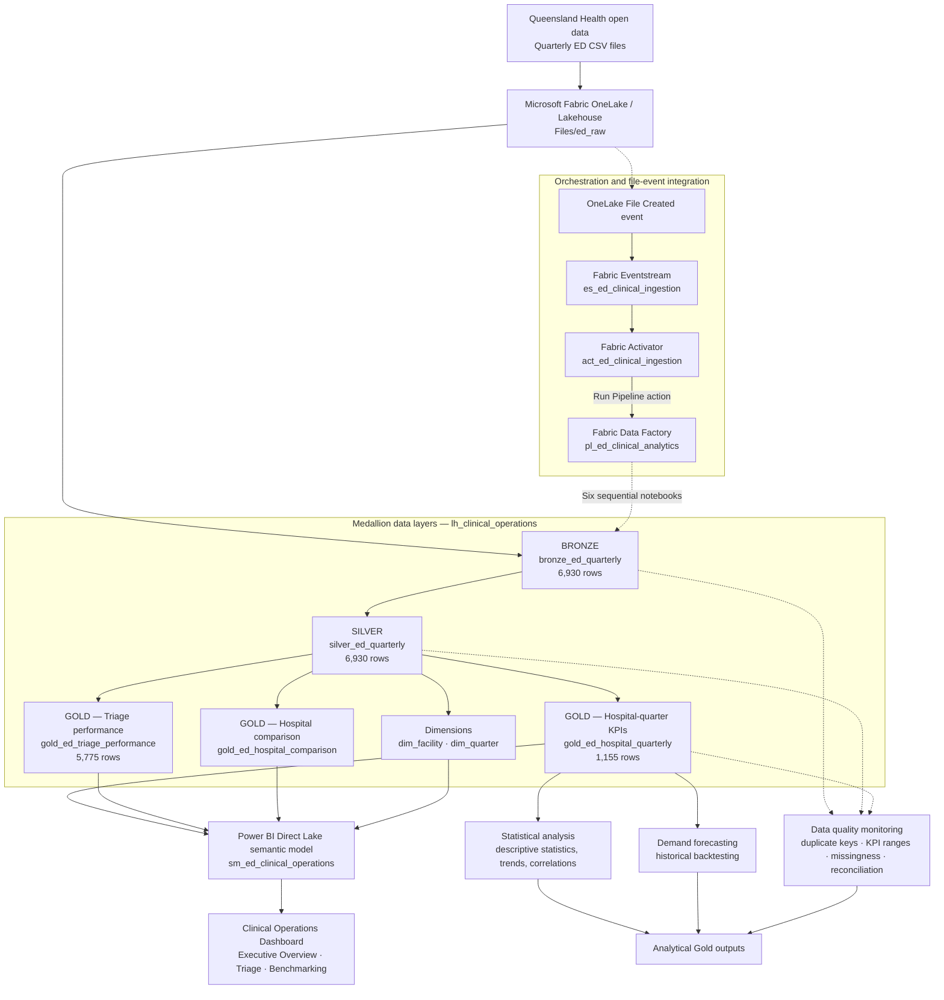

# Queensland Clinical Data Analytics — Medallion Architecture

## Overview

This project uses Microsoft Fabric to ingest public Queensland Health quarterly Emergency Department (ED) CSV data, standardise it in a Lakehouse, and deliver curated datasets for Power BI, statistical analysis, demand forecasting, and data quality monitoring.

**Workspace:** `queensland-clinical-analytics`  
**Lakehouse:** `lh_clinical_operations`  
**Pipeline:** `pl_ed_clinical_analytics`  
**Current input:** 11 included quarterly CSV files; 6,930 records; 11 reporting quarters. One September 2022 CSV is excluded by ingestion configuration.

## Architecture diagram

> **Integration verification:** A OneLake file-created event was observed in Activator, and Activator's test action successfully submitted a run of the six-stage pipeline. However, automatic **CSV-arrival → pipeline execution** has not yet been confirmed in an end-to-end positive-trigger test. Do not describe that final behaviour as fully validated.

## Data layers and transformations

| Layer | Table or location | Main operations | Verified scope |
|---|---|---|---|
| Raw | `Files/ed_raw` | Uploaded source CSVs in OneLake | 11 included files |
| Bronze | `bronze_ed_quarterly` | Dynamic CSV discovery, string-preserving reads, column-name harmonisation, expected-schema validation, `source_file` lineage, `unionByName` | 6,930 rows |
| Silver | `silver_ed_quarterly` | Integer and double conversions with `try_cast`, reporting-month date parsing, normalised triage labels, conversion diagnostics | 6,930 rows |
| Gold (hospital) | `gold_ed_hospital_quarterly` | Hospital/facility-quarter reporting grain, clinical KPIs | 1,155 rows |
| Gold (triage) | `gold_ed_triage_performance` | Separate triage categories 1–5 | 5,775 rows |
| Gold (comparison) | `gold_ed_hospital_comparison` | Six-facility benchmarking dataset for selected period | 6 selected facilities |
| Dimensions | `dim_facility`, `dim_quarter` | Facility and reporting-period lookup tables | Created |

**Grain warning:** The source has triage categories `1`–`5` plus an `ALL` total for each facility and quarter. Never sum `ALL` together with `1`–`5`; that would double-count attendances. Rates and medians must not be naively added, and cross-facility averages require appropriate denominators and interpretation.

## Data Factory execution order

The `pl_ed_clinical_analytics` pipeline orchestrates six notebooks in sequence:

1. `nb_01_ed_data_exploration` — source exploration and Bronze ingestion.
2. `Notebook_1nb_02_ed_silver_transformation` — Silver type and value standardisation.
3. `Notebook_1nb_03_ed_gold_analytics` — Gold analytical tables.
4. `nb_04_ed_statistical_analysis` — descriptive, trend and correlation statistics.
5. `nb_05_ed_demand_forecasting` — forecast baselines and historical evaluation.
6. `nb_06_ed_data_quality_monitoring` — checks and quality summary.

A successful six-stage pipeline run was observed. The most recent reported Bronze baseline after an Activator test action remained **6,930 rows, 11 source files and 11 quarters**.

## Analytical outputs

| Component | Table(s) / item | Notes |
|---|---|---|
| Statistics | `gold_ed_descriptive_statistics`, `gold_ed_trend_statistics`, `gold_ed_correlation_statistics` | Time-series summaries, regression trends, correlations and sensitivity analysis |
| Forecasting | `gold_ed_forecast_evaluation`, `gold_ed_demand_forecast` | Naive one-step baseline: historical backtest MAE 309.88, RMSE 398.62, MAPE 1.96%; not a clinical forecast validation |
| Data quality | `gold_ed_data_quality_summary` | Duplicate, range, missingness and attendance-reconciliation checks with PASS/WARNING outcomes |
| BI | `sm_ed_clinical_operations` | Three-page Power BI dashboard: Executive Overview, ED Triage Performance, Hospital Benchmarking |

## Validation controls and current limitations

- **Bronze schema gate:** Normalises `Triage_Category` and missing `Median Wait Traffic Light`, then raises a `ValueError` if required columns are missing or unexpected columns appear.
- **Duplicate inspection:** Checks repeated facility–quarter–triage combinations; previously observed zero duplicate groups. Whether the check is configured to fail the notebook must be confirmed from the latest saved code.
- **Silver conversion validation:** `INT` and `DOUBLE` conversion diagnostics; a recently tested check reported zero unexpected failures under the configured missing-marker policy. Exact accepted missing markers should be reviewed against source documentation.
- **Data quality stage:** Includes duplicate-key, KPI-range, missingness and attendance-total reconciliation checks. Quality findings are recorded, but not every failure is currently a blocking gate for earlier Gold writes.
- **Not yet verified:** Full independent source-CSV-to-persisted-Bronze value reconciliation; comprehensive Bronze-to-Silver row-level value reconciliation; positive automatic CSV-arrival-to-pipeline test; concurrency/deduplication handling for multiple file-created events.

## Repository placement

Recommended path: `docs/architecture/medallion-architecture.md`.

For the field-level transformation reference, see [`../schema-mapping.md`](../schema-mapping.md).
